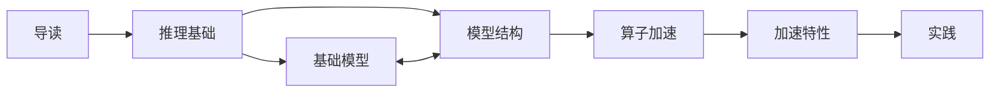
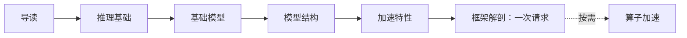
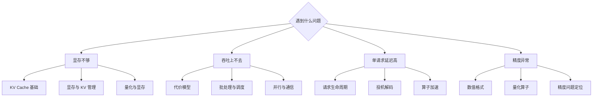

# 导读

> LLM 大模型入门基础教程：从基础模型架构到最终的算子执行，逐步构建推理加速知识地图。每个层次都用尽量直观的可视化拆解，从基础公式入手，配合源码食用更佳。

## 整体架构

按“从模型架构到算子执行”的顺序展开，共七卷：

| 卷 | 回答的问题 | 主要内容 |
|---|---|---|
| [导读](/learn/inference/introduction) | 读之前要补哪些通用前置 | 本教程怎么用、知识库思路、概率论、信息论、硬件基础、推理 benchmark |
| [推理基础](/learn#part-foundations) | 一次推理的账本是什么 | 请求生命周期、代价模型、KV Cache、数值格式 |
| [基础模型](/learn#part-families) | 主流模型长什么样 | GLM、DeepSeek、Qwen、Kimi 的结构、变体与推理影响 |
| [模型结构](/learn#part-architecture) | 结构如何组成 | 词嵌入、tokenizer、位置编码、注意力变体、MoE、FFN/Norm、长上下文结构 |
| [算子加速](/learn#part-operators) | 结构如何落到设备上 | GEMM、Grouped MatMul、FlashAttention、PagedAttention、mRoPE with cache、MegaMoE、量化算子 |
| [加速特性](/learn#part-systems) | 系统如何把算子组织成服务 | 调度、显存与 KV 管理、量化与显存、投机解码、并行与通信、长上下文推理、框架解剖、性能工程 |
| [实践](/learn#part-practice) | 怎么调优与排障 | 性能调优实战、精度问题定位、nano 项目地图 |

一个记忆方法：**模型结构决定要算什么，算子决定怎么算得快，系统决定什么时候算、在哪里算、和谁一起算。**

实线是建议顺序；基础模型与模型结构互为镜像、可互换。系统卷的“框架解剖”会把前面各层串成一次完整请求。

## 学习建议

按目标选一条路线，不必从头读到尾。

**路线 A · 系统入门**：先建立“一次请求如何跑完”的全局，再按需补算子。

**路线 B · 算子与性能**：适合已经在做推理优化、需要看懂 kernel 与 profiler 的读者。

**路线 C · 问题驱动**：带着问题查，不按卷序。

## 写在最后

读完导读，建议直接进入《推理全景：一次请求的一生》；如果想先了解这套内容如何组织与维护，读[《知识库核心思路》](/learn/inference/knowledge-base-method)。

内容会持续修订。发现错误、想补充章节，或想交流推理优化，欢迎通过下面的方式找到我：

- 网站仓库：[csoulnd/daimonkey](https://github.com/csoulnd/daimonkey)
- 知识库：[csoulnd/InferTechNote](https://github.com/csoulnd/InferTechNote)
- 邮箱：[daidaicurry@foxmail.com](mailto:daidaicurry@foxmail.com)

## 修订记录

| 日期 | 版本 | 改动 |
|---|---|---|
| 2026-10-23 | v0.1 | 初稿：五卷结构、读法、写作约定 |
| 2026-10-24 | v0.2 | 按“从模型架构到算子执行”重排为七卷 |
| 2026-10-24 | v0.3 | 精简结构：加整站地图与三张学习路线图，删主题归属、知识库关系与末尾问答 |
| 2026-10-24 | v0.4 | 卷名改为入口链接；去掉整站地图表，改为知识架构图 |
| 2026-10-24 | v0.5 | 删除首节 |
| 2026-10-24 | v0.6 | 删除“每一篇的约定”，移入《知识库核心思路》 |
